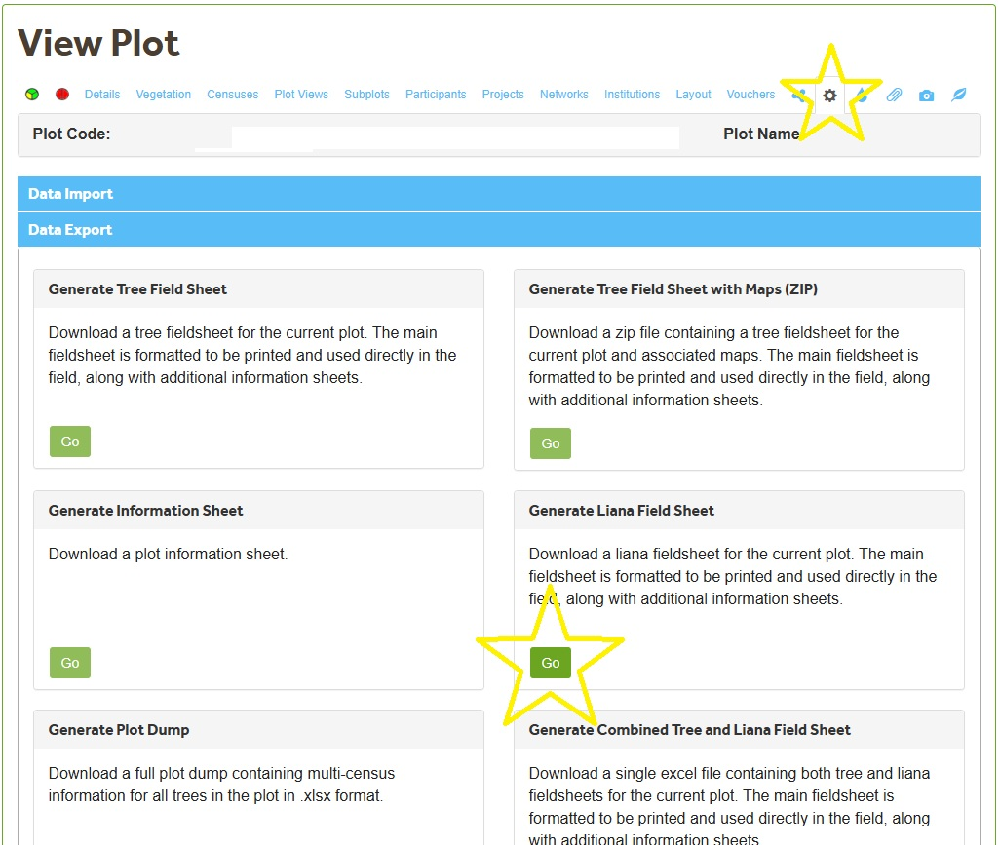
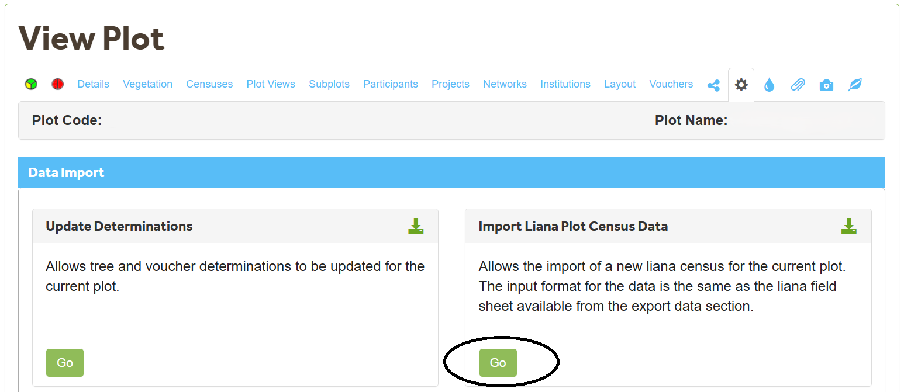
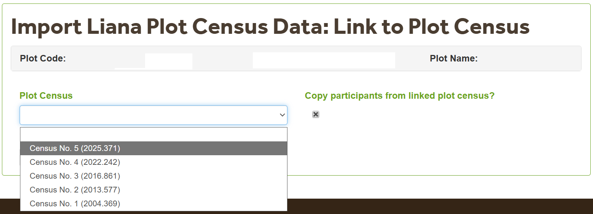

# Liana data {-}

## Collecting liana data

To collect liana data for a new plot, you can use a [liana fieldsheet](https://view.officeapps.live.com/op/view.aspx?src=https%3A%2F%2Fsecure.forestplots.net%2FSiteTemplates%2Fen%2FLianaCensusImportTemplate.xlsx&wdOrigin=BROWSELINK). 

If you already have existing liana data, then generate a liana fieldsheet on ForestPlots from within your plot. See below!

&nbsp;

&nbsp;

## Prepare data for upload

Data must be in the exact correct format before being uploaded to ForestPlots. So first and foremost, ensure you have all the necessary columns and that they are spelled exactly how they are listed on the [liana fieldsheet](https://view.officeapps.live.com/op/view.aspx?src=https%3A%2F%2Fsecure.forestplots.net%2FSiteTemplates%2Fen%2FLianaCensusImportTemplate.xlsx&wdOrigin=BROWSELINK).

To understand how to fill in each column, view the Definitions tab of the [liana fieldsheet](https://view.officeapps.live.com/op/view.aspx?src=https%3A%2F%2Fsecure.forestplots.net%2FSiteTemplates%2Fen%2FLianaCensusImportTemplate.xlsx&wdOrigin=BROWSELINK). 

If you still encounter issues, here is some information to help address some of the most common mistakes that people make:

### `Tag No` versus `New Tag No` column

`Tag No` contains all of the tag numbers of the liana stems, but what is the purpose of the `New Tag No` column?

The `New Tag No` column is used to update the tag numbers of stems in Forestplots. When uploading data, only the `New Tag No` column will be used, not `Tag No`. 

Whether you are uploading lianas for the first time or uploading an additional liana census, use the `New Tag No` column.

When uploading lianas for the first time, there are no records of tag numbers so you must write all of the tag numbers in the `New Tag No` column. 

When uploading an additional liana census, there are existing tag numbers in the database. Therefore, you do not need to upload all of the tag numbers again. Instead, you only need to upload the tag numbers for 

1. new recruits (stems that have no records of a tag number) and  
2. stems that have had their tag number changed.  
Therefore, fill in the `New Tag No` column for all new recruits or when a liana's tag number changes. There is no need to fill in the `New Tag No` column for a stem whose tag remains the same.

### Have you filled `Most Affected Tree` and `Host trees` columns correctly?

The `Most Affected Tree` and `Host trees` column must contain the Tree ID of the tree you are referencing, not the Tag No. 

Most people find this frustrating because the field sheet gives this value as the tag number and not the Tree ID. The reason for this is that as you can imagine the tag number is more helpful in the field than the Tree ID. But if the Tree ID is not given to you in the field sheet how do you find it?

To get the Tree ID, you can go to the Vegetation tab of your plot, click Trees, and search the Tag No in this section and copy the Tree ID from here.

&nbsp;

&nbsp;

You can also download a Plot Dump and find the tree and Tree ID there.

### Fill in the flag3 and flag4 column for alive lianas!

It is commonly forgotten to fill in the Flag3 and Flag4 columns (L.F3, L.F4, etc.). However, it is a requirement of ForestPlots to fill these in. 

As a quick summary, flag 3 describes how the measurement was taken and Flag 4 describes whether the value was modified. For most cases, you can fill in the Flag 3 and Flag 4 columns as 0. However, if the diameter was measured with something other than a tape measure or was retrospectively modified, then view the Flag options [here](https://forestplots.net/upload/ManualsEnglish/RAINFOR_LianaDataCodes_EN.pdf) and fill in the column with the correct code.

## Upload data

To upload liana data, navigate to the `Data Import` section and click 'Go'!

&nbsp;

&nbsp;

**Hint: the green down arrow button next to "Import Liana Plot Data" contains the upload template you filled in earlier.**

The "Plot Census" button refers to the tree censuses that are stored in ForestPlots. Since lianas are typically collected at the same time as trees, choose the tree census that occurred simultaneously as the liana census that is being currently being uploaded.

The button, "Copy participants from linked plot census?", allows for all participants in the chosen Plot Census to be automatically copied to the liana census being uploaded. Click this button if all participants of the associated tree census should be associated with the liana census being uploaded.

&nbsp;

&nbsp;

Fill in the census dates and any comments that you need to be uploaded for this census.

Select the file to be uploaded. 

If there is anything wrong with the data you are trying to upload, you will be told here. You can either fix the individual issues here or go back to the Excel file, fix the issues, and re-do the upload.

## Sign off data

Once the data has been uploaded, we need to check that the data is okay.

The first step is to run the 'Liana Dynamics' Query which will tell us whether the data is consistent or not:

 * Click on the `Query Library Icon` on the left-hand side of the screen  
 * Select 'Private' 
 * Click on 'Lianas' in the empty box 
 * Select 'Liana Dynamics', click on the green arrow  
 * Click 'next' 
 * Filter for your plots, then add your plots by selecting the 'add' icon (*You can add many at a time*)  
 * Click 'Next' at the bottom of the page 
 * Select 'Save to excel' 
 * Open the Excel file and check the last column 'Consistency Check' where we expect all of the values of this column to be zero  
   * If 0, no inconsistencies were found in the liana data (move to sign off the data) 
   * If 1, extra values were found in the liana data (check the data for lianas recorded as alive after being recorded as dead)  
   * If -1, missing values were found in the liana data (check the data for lianas with missing information) 
  
### Fix the inconsistencies in the liana data

#### Extra values in the liana data

If you find that the Consistency Check in the Lianas Dynamic Query has given you a number greater than 0, then it typically means that a liana was recorded as dead or not recorded. 

To check for this, you can either download a liana field sheet and manually look for these trees, or you can generate a list of the lianas that have an issue. To generate the list of lianas that have back to life lianas or missing lianas, follow these steps:

 * Click on the `Query Library Icon` on the left-hand side of the screen  
 * Select 'Private' 
 * Click on 'Lianas' in the empty box 
 * Select ‘QC Lianas recorded as Alive after being recorded as Dead’  
 * Select the necessary plot(s) 
 * Click ‘Next’ on the bottom of the page 
 * Select ‘Save to excel’ 
 
This excel file now has a list of the plots (column B), lianas (column E), and the census where the liana came back to life or was missed (column F and I).

#### Missing values in the liana data

If you find that the Consistency Check in the Lianas Dynamic Query has given you a number greater than 0, then it typically means that a liana was missed in the data.

To check for this, you can either download a liana field sheet and manually look for these trees, or you can generate a list of the lianas that have an issue. To generate the list of lianas that have back to life lianas or missing lianas, follow these steps:

 * Click on the `Query Library Icon` on the left-hand side of the screen  
 * Select 'Private' 
 * Click on 'Lianas' in the empty box 
 * Select ‘QC Lianas with missing censuses’ 
 * Select the highlighted plots 
 * Click ‘Next’ on the bottom of the page 
 * Select ‘Save to excel’ 

This Excel file now has the list of plots (column B) and the lianas (columns E and F) that have one or more censuses missing (Column C).

#### Fix the issues on ForestPlots

To fix the issues identified above, we recommend downloading a liana field sheet, viewing the errors there in its entirety, and modifying the errors there in a different color.

To download the field sheet,

 * Go to the plot and select 'Data Export'  
 * Click on ‘Generate Liana Field Sheet’  
 * Open the excel file and check the values of flagged lianas 
 * To correctly modify the data, first check the values against the original field sheets or, when field sheets are not available, in the original data 
 * If values are missing, interpolate the diameter when necessary 
 
Once you have identified the errors, and recorded the changes you want to make, you can modify each liana one-by-one on the ForestPlots platform:

 * Open the plot on the platform and go to ‘Vegetation’ 
 * Click on arrow in box to select ‘Lianas’ 
 * Search for the lianas using the `Tag No` or `Tree ID` column 
 * Correct the values manually by clicking the magnifying glass icon, then edit   
 
After all of the values have been modified, re-run the 'Liana Dynamics' Query and repeat these steps if necessary.

### No inconsistencies in the liana data 

When there are no inconsistencies in the liana data (aka Consistency Check = 0), we can sign off the the liana data!

To sign off the liana data,

* Open the plot 
* Click 'Details' on the plot menu  
* Click 'Edit' in the top right 
* Click on the 'Forest Inventory' section 
* Fill in the information 'Liana Sample' with "Where the liana data is stored + the liana census you signed off + the date the liana census was signed off", e.g. **ForestPlots.net; Liana Census 3; QCJan2026** 

Even though the data has been signed off, it does not mean that people with access to this plot can see this liana census. To check if the liana data has been released to all members who have access to the plot,

* Navigate to the Plot page 
* Click Censuses  
* Choose Liana Censuses 

If the lock is red, this means only you can see the liana plot census. 
If the lock is green, this means everyone who has access to the plot can see the liana census.

It is important to ensure everyone in your plot can see the liana census. To change the view rights of this census,

* Click the magnifying glass icon at the right of the census  
* Click Edit  
* And ensure "Is Released to My Plots" is set to TRUE 

## All done!

Top work! Now you have uploaded and signed off liana data to your plot. Congratulations!