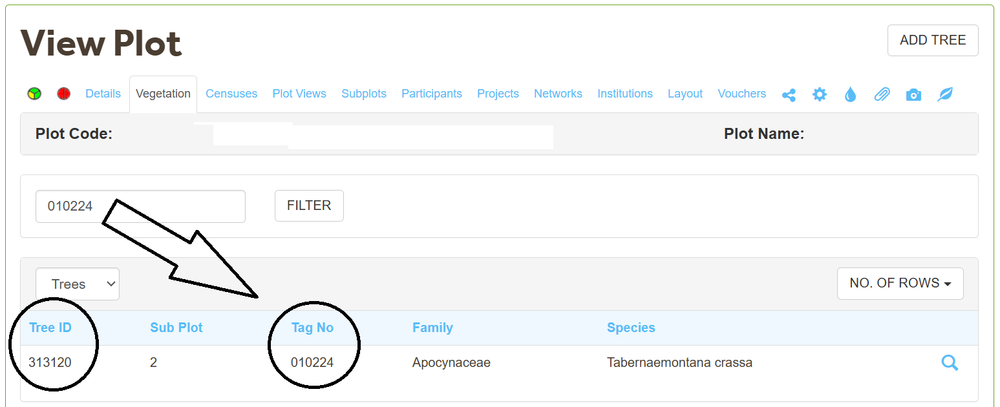

# Common Issues & FAQs {#faq}

## Data entry {#faq-data-entry}

What is the difference between `Tag No` and `New Tag No`?

 

* `Tag No` stores all of the tag numbers of the stems in the ForestPlots database.
* `New Tag No` is used during upload to update the tag numbers in Forestplots. 

When uploading data, use the New Tag No column to upload the tags of 

1. new recruits (stems that have no records of a tag number) and  
2. stems that had their tag changed.

The Explanation?

When uploading stems for the first time, there are no records of tag numbers so you must write all of the tag numbers in the New Tag No column to update the tags in the database. 

When uploading an additional census, there are existing tags in the database. Therefore, you do not need to upload all of the tags again. Instead, you only need to upload the tags for new recruits or stems that had their tag changed.

Therefore, fill in the New Tag No column for all new recruits or when a stem's tag number changes. There is no need to fill in the New Tag No column for a stem whose tag remains the same since the database already has this information.

Do I need to add an `original identification` column?

 
Yes! The `original identification` column enables you to write the identification that was recorded in the field. 

The Family and Species columns take a very specific format using indet for unknown parts of the taxonomy. Therefore, the original identification column gives you a place to record the identification exactly as it was recorded in the field, even if it is not a certified species according to World Flora Online.

How do I fill in `Flag3` and `Flag4` for trees?

 
If the stem is dead, leave Flag3 and Flag4 empty. However, Flag3 and Flag4 must be filled in when a stem is alive because:

* `Flag3` describes how the measurement was taken, and
* `Flag4` describes whether the diameter value was modified.

If the stem is alive and was measured normally with a tape measure and not modified, write 0.

Otherwise, if the diameter was measured with something other than a tape measure or was retrospectively modified, then view the Flag options for [trees here](https://forestplots.net/upload/ManualsEnglish/RAINFOR_data_codes_EN.pdf) and [lianas here](https://forestplots.net/upload/ManualsEnglish/RAINFOR_LianaDataCodes_EN.pdf) and fill in the flag columns with the appropriate code that describes the measurement technique or diameter modification. 

*Please note that all modifications to the diameter should occur after upload and the diameter columns should contain the original measurement recorded in the field.*

How do I fill in `Flag3` and `Flag4` for lianas?

 
It is commonly forgotten to fill in the Flag3 and Flag4 columns (L.F3, L.F4, etc.). However, it is a requirement of ForestPlots to fill these in. 

As a quick summary, Flag3 describes how the measurement was taken and Flag4 describes whether the value was modified. For most cases, you can fill in the Flag3 and Flag4 columns as 0. However, if the diameter was measured with something other than a tape measure or was retrospectively modified, then view the Flag options [here](https://forestplots.net/upload/ManualsEnglish/RAINFOR_LianaDataCodes_EN.pdf) and fill in the column with the correct code.

Have you filled `Most Affected Tree` and `Host trees` columns correctly?

 
The `Most Affected Tree` and `Host trees` column must contain the Tree ID of the tree you are referencing, not the Tag No. 

Most people find this frustrating because the field sheet gives this value as the tag number and not the Tree ID. The reason for this is that as you can imagine the tag number is more helpful in the field than the Tree ID. But if the Tree ID is not given to you in the field sheet how do you find it?

To get the Tree ID, you can go to the Vegetation tab of your plot, click Trees, and search the Tag No in this section and copy the Tree ID from here.

&nbsp;

&nbsp;

You can also download a Plot Dump and find the tree and Tree ID there.

 
**Have a question? Reach out to the ForestPlots team, and we can answer your question and add it here to help others in the future!**

---

<!-- ## Data entry -->

<!-- **Q: What should I do if a stem has died between censuses?** -->

<!-- *[Answer]* -->

<!-- **Q: Can I enter data from multiple censuses at the same time?** -->

<!-- *[Answer]* -->

<!-- **Q: How do I handle a re-tagged stem where the original tag was lost?** -->

<!-- *[Answer]* -->

<!-- --- -->

<!-- ## Data quality -->

<!-- **Q: I received a validation error for a DBH value I am confident is correct — what do I do?** -->

<!-- *[Answer]* -->

<!-- **Q: Can I override a validation flag?** -->

<!-- *[Answer]* -->

<!-- --- -->

<!-- ## Querying and downloading -->

<!-- **Q: I can see a plot but the download button is greyed out — why?** -->

<!-- *[Answer]* -->

<!-- **Q: How do I request access to data that is under embargo?** -->

<!-- *[Answer]* -->

<!-- **Q: What format should I cite when using downloaded data in a publication?** -->

<!-- *[Answer]* -->

<!-- --- -->

<!-- ## R package -->

<!-- **Q: The R package says my credentials are invalid, but I can log in on the website — what's wrong?** -->

<!-- *[Answer]* -->

<!-- **Q: How do I report a bug in the R package?** -->

<!-- *[Answer]* -->

<!-- --- -->

<!-- ## Getting further help -->

<!-- If your question is not answered here, please contact the ForestPlots.net team: -->

<!-- - **Email:** *[support email]* -->
<!-- - **Help forum:** *[link]* -->
<!-- - **GitHub Issues (R package):** *[link]* -->
